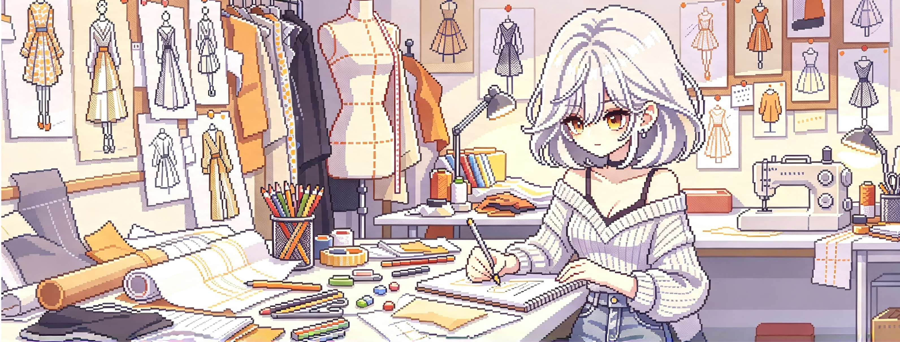

<table>
<tr>
<td valign="middle"></td>
<td valign="middle"><b><a href="README.md">English</a> · <a href="README.ja.md">日本語</a> · <a href="README.ko.md">한국어</a></b></td>
</tr>
</table>

### Hi, I'm mivork

Gender: Male 
From: Japan

### Projects

- [hal-kindergarten-portfolio](https://github.com/mivork/hal-kindergarten-portfolio) — portfolio site built around a fictional kindergarten
- [breakout-python](https://github.com/mivork/breakout-python) — Block Breaker written in Python

---

If you find this profile useful, please follow me on GitHub: **[@mivork](https://github.com/mivork)**

---

*Languages: [English](README.md) · [日本語](README.ja.md) · [한국어](README.ko.md)*

